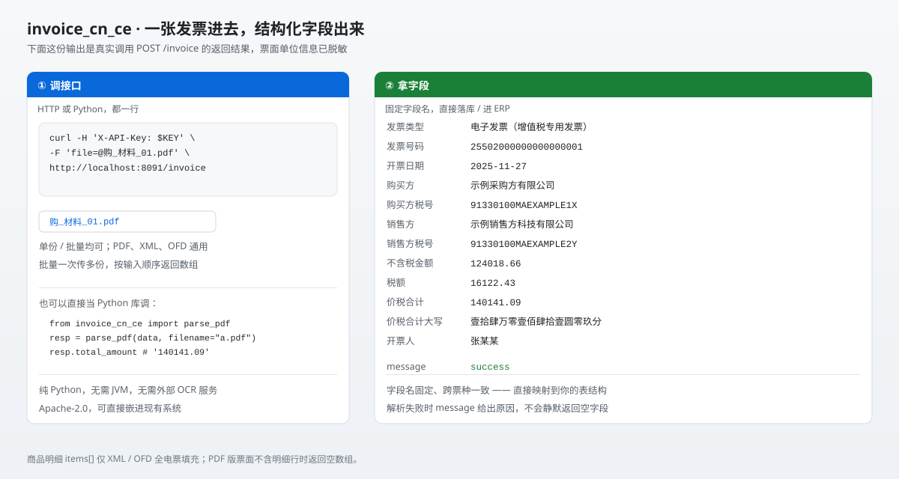
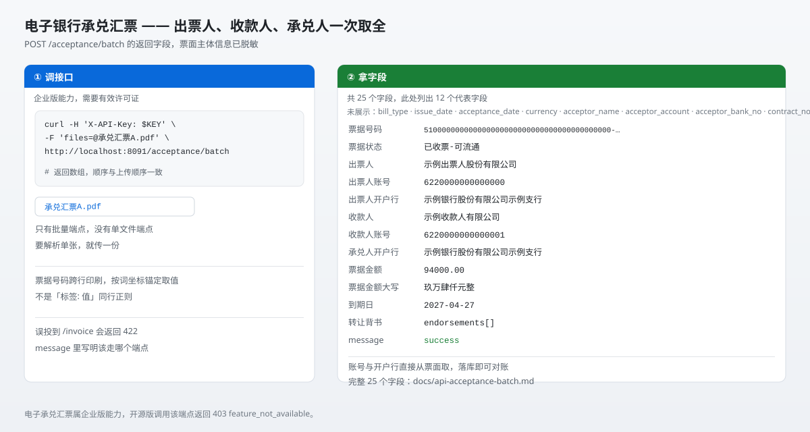
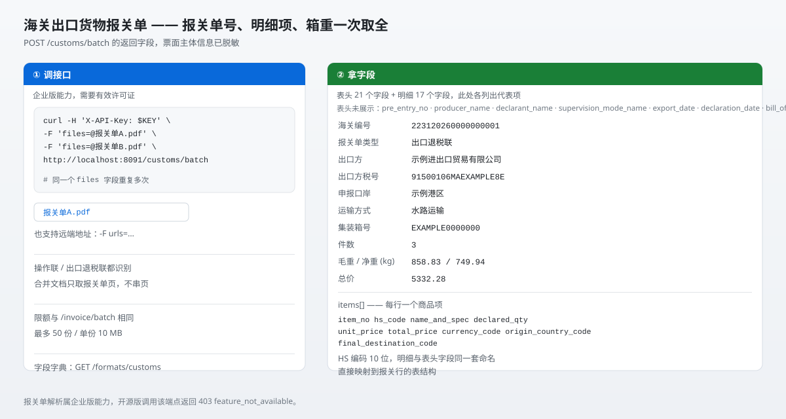

# Invoice-CN CE

[](https://github.com/giwu-lab/invoice_cn_ce/actions/workflows/ci.yml)
[](LICENSE)
[](https://www.python.org/downloads/)
[](https://github.com/giwu-lab/invoice_cn_ce)

**中国财务票据解析服务** —— 把发票、报关单、银行承兑汇票、行程单、客票这些财务票据，
解析成固定字段名的结构化数据，给财务系统、代账公司、ERP 对接用。

一张票据进去，结构化数据出来：票据号码、购销方全称与统一社会信用代码、金额税额、
大写金额、商品明细、银行账号与开户行、箱重件数 —— **跨票种字段名一致**，直接映射表结构。



纯 Python 实现（`pdfplumber`），**无需 JVM、无需外部 OCR 服务**，Apache-2.0。
既能当 HTTP 服务跑，也能进程内直接调用。

---

## 数据留在你自己手里

一张发票不是普通附件。它里面有：

- **购销双方公司全称 + 统一社会信用代码** —— 企业的身份信息；
- **金额、税额、价税合计** —— 经营数据；
- **银行账号与开户行** —— 承兑汇票上直接印着；
- **商品明细** —— 品类、规格、数量、单价。

这几项凑齐，足够还原一家公司的采购与销售流水、以及它的上下游关系。

所以本项目**按「跑在你自己机器上」来设计**，而不是按「把文件发到某个云上」：

| | 发给第三方 API | 部署在自己机器上 |
| --- | --- | --- |
| 票据原件 | 离开你的网络 | 只在本机内存里 |
| 提取出的字段 | 落在对方服务器 | 只进你自己的库 |
| 谁在处理你的数据 | 对方 | 你 |
| 想停就能停 | 不能 | 能，进程停了就没了 |
| 批量成本 | 按张 / 按量计费 | 机器已经在跑，边际成本≈0 |
| 合规 | 涉及数据出境与第三方评估 | 数据不出内网，不涉及 |

三条落地要点：

1. **它虽是 HTTP 服务，但可以只留在内网。** `IC_HOST=127.0.0.1` 就只有本机能访问；要给局域网里的财务系统用，绑内网地址即可，**不需要暴露到公网**。
2. **也可以完全不用 HTTP。** `from invoice_cn_ce import parse_pdf` 直接在 Python 进程里解析 —— 字节不进网络、不落盘、不进日志，你的 ERP 读个文件就完事。
3. **票据原件不会留在容器里。** 服务只读你传进去的字节；审计日志记的是路径、字节数、状态码，**不记票面内容**。

---

## 五个模块

### 1 · 票据解析模块 —— 票种自动识别

传什么票它就用什么解析器，**调用方不用写 if-else**。

| 票种 | `formats` 标识 | 输入 | 发行版 |
| --- | --- | --- | --- |
| 电子发票（专票 / 普票）标准新格式 —— 含京东、水费、通行费变体 | `new` | PDF | CE |
| 电子发票（普票）平台下载版 —— 票面标签块在上、值块在下，按词坐标重建阅读顺序 | `platform` | PDF | CE |
| 电子发票（普票）旧格式 —— 含密码区、校验码 | `old` | PDF | CE |
| 电子发票（普票）合并代码 / 成品油变体 | `merged_code` | PDF | CE |
| 中央非税收入统一票据（电子）—— 专利年费、行政事业性收费等 | `non_tax_receipt` | PDF | CE |
| 电子发票（航空运输电子客票行程单） | `airline` | PDF | CE |
| 电子发票（铁路电子客票） | `train` | PDF | CE |
| 全电发票（数电票） | — | XML / OFD | CE |
| 海关出口货物报关单 —— 操作联 / 出口退税联 | `customs` | PDF | EE |
| 电子银行承兑汇票 | `acceptance` | PDF | EE |

- **XML / OFD 全电票是唯一会填满 `items[]` 商品明细的路径** —— PDF 票面本身没有明细行。
- 各票种字段名统一为 `snake_case`，**跨票种一致**，字段含义见 [输出字段](docs/output-fields.md)。
- `GET /formats` 会如实列出这台服务**当前真的能解析**的票种 —— 未授权的企业版票种不会出现。

### 2 · 接口模块 —— 一组可预测的 HTTP 端点

| 端点 | 作用 | 发行版 |
| --- | --- | --- |
| `POST /invoice` | 单份票据提取 | CE |
| `POST /invoice/batch` | 批量提取，并行处理，按输入顺序返回数组 | EE |
| `POST /raw` | PDF 原始文本（解析失败时用来人工兜底） | CE |
| `POST /verify` | 国税查验代理（需 `IC_VERIFY_ENABLED=true`） | CE |
| `POST /extract-and-verify` | 提取 + 查验一站式 | CE |
| `GET /formats`、`/formats/customs`、`/formats/acceptance` | 票种列表与字段字典 | CE |
| `GET /capabilities` | 当前发行版与可用能力 | CE |
| `GET /health`、`/health/full` | 健康检查 | CE |
| `POST /customs/batch` | 海关出口货物报关单 | EE |
| `POST /acceptance/batch` | 电子银行承兑汇票 | EE |

三种入参形状随便混用：**上传文件**、**远端 URL**、**base64**；JSON 里还能给服务端路径。
限额默认单份 10 MB、批量 50 份 / 合计 500 MB。

### 3 · 鉴权与审计模块 —— key 不进镜像，审计不记票面

- **API Key + scope**：`X-API-Key` 或 `Authorization: Bearer`，scope 分 `extract` / `verify` / `admin`。
- **key 不进镜像**：从 `keys.json` 或 `IC_API_KEYS` 读，生产环境用 secret manager 注入。
- **审计日志只记元数据**：路径、字节数、状态码、耗时 —— **不记票面内容**，也不记响应正文。
- **错误是结构化的**：401 / 403 / 404 / 422 各带 reason 码，批量端点里错误落在**该项**上，整批照常返回。

详见 [鉴权与审计](docs/auth.md)。

### 4 · 发行版模块 —— CE / EE，许可证控制

| 发行包 | 许可 | 能力 |
| --- | --- | --- |
| `invoice_cn_ce` | Apache-2.0 | 常规票种提取 `/invoice`、字段字典 `/formats`、原始文本 `/raw`、查验 `/verify` |
| `invoice_cn_ee` | 商业授权 | 追加：批量提取 `/invoice/batch`、报关单 `/customs/batch`、电子承兑汇票 `/acceptance/batch` |

**两版路由表完全一致** —— 开源版里企业版端点照样存在，只是返回结构化 403
`feature_not_available`（不是 404），客户端可以按能力位决定要不要显示入口。
企业版能力由**许可证**控制，不是运行时的开关：没授权就自动降级成开源版行为，不会让服务起不来。

详见 [发行版与许可证](docs/editions.md)。

### 5 · 部署与集成模块 —— 三种跑法

| 跑法 | 适合谁 |
| --- | --- |
| **Docker** | 最省事：`docker compose up -d`，镜像 249 MB，key 走挂载不进镜像 |
| **源码运行** | 已经在自己的 Python 环境里：`pip install -e .` 后用 `scripts/start-win.ps1` / `scripts/entrypoint.sh` 起 |
| **进程内调用** | 纯 Python 技术栈：`from invoice_cn_ce import parse_pdf`，字节不出进程 |

```python
# 进程内直接调（Python 技术栈）—— 字节不出进程
from invoice_cn_ce import parse_pdf

resp = parse_pdf(open("发票.pdf", "rb").read(), filename="发票.pdf")
print(resp.seller_name, resp.total_amount, resp.message)
```

```bash
# 跨语言 / 独立部署（HTTP）
curl -H "X-API-Key: $KEY" -F "files=@a.pdf" -F "files=@b.pdf" \
     http://localhost:8091/invoice/batch
```

详见 [部署与开发](docs/deployment.md)。

---

## 30 秒跑起来

```bash
docker compose up -d

curl -H "X-API-Key: $KEY" \
     -F "file=@发票.pdf" \
     http://localhost:8091/invoice
```

返回（真实响应结构，票面单位信息已脱敏）：

```json
{
  "invoice_type": "电子发票（增值税专用发票）",
  "invoice_number": "25502000000000000001",
  "issue_date": "2025-11-27",
  "buyer_name": "示例采购方有限公司",
  "buyer_tax_id": "91330100MAEXAMPLE1X",
  "seller_name": "示例销售方科技有限公司",
  "seller_tax_id": "91330100MAEXAMPLE2Y",
  "amount_without_tax": "124018.66",
  "tax_amount": "16122.43",
  "total_amount": "140141.09",
  "total_amount_upper": "壹拾肆万零壹佰肆拾壹圆零玖分",
  "drawer": "张某某",
  "message": "success"
}
```

> `X-API-Key` 从 `keys.json` 或 `IC_API_KEYS` 取，**key 不进镜像**，见 [鉴权与审计](docs/auth.md)。

## 它替你干掉了什么

| 原来要干的活 | 现在 |
| --- | --- |
| 人工把票面字段抄进系统 | 一次 HTTP 调用，字段名固定 |
| 自己判断这是哪种票 | 票种自动识别，不用写 if-else |
| 各系统字段名不一样 | 统一 snake_case，**跨票种一致**，直接映射表结构 |
| 票面解析错了却不知道 | `message` 给出具体原因，不静默返回空字段 |
| 一个一个文件传（企业版） | 一次传多份，并行处理，按输入顺序返回数组 |

## 边界要说清楚

信任比功能重要，所以这几条先讲在前面：

- **PDF 票面没有明细行时，`items[]` 返回空数组** —— 商品明细只有 XML / OFD 全电票才有。这是票面本身就没有，不是解析失败。
- **解析失败不会静默返回空字段** —— `message` 字段给出原因（`error: parse_failed: ...`）。批量端点里错误落在**该项**上，整批照常返回，不会因为一张坏票丢掉整批。
- **不做 OCR** —— 扫描件（图片型 PDF）没有文字层，解析会失败并说明原因。本项目处理的是电子票据，不是拍照件。
- **批量提取、报关单、电子承兑汇票是企业版能力** —— 见「发行版模块」。

## 文档

完整文档在 [`docs/`](docs/README.md)，每个接口一份独立文件：

| 文档 | 讲什么 |
| --- | --- |
| [部署与开发](docs/deployment.md) | Docker / 源码 / 进程内三种跑法、构建、Windows 注意事项 |
| [接口一览](docs/api-overview.md) | 端点总表、通用入参、限额、错误约定 |
| [输出字段](docs/output-fields.md) | 每个字段的含义、`items[]`、`message` 语义 |
| [鉴权与审计](docs/auth.md) | API Key、scope、错误码、`audit.log` |
| [配置项](docs/config.md) | 全部 `IC_*` 环境变量 |
| [发行版与许可证](docs/editions.md) | CE / EE 边界、许可证机制 |
| [解析器与票种](docs/parsers.md) | 每个票种由哪个模块解析 |
| [批量端点入参](docs/batch-input.md) | 三种文件来源与混传规则 |
| [测试](docs/testing.md) | 怎么跑测试、样本从哪来 |

单接口文档：`[/invoice](docs/api-invoice.md)` · `[/invoice/batch](docs/api-invoice-batch.md)` · `[/raw](docs/api-raw.md)` · `[/verify](docs/api-verify.md)` · `[/extract-and-verify](docs/api-extract-and-verify.md)` · `[/formats](docs/api-formats.md)` · `[/capabilities](docs/api-capabilities.md)` · `[/customs/batch](docs/api-customs-batch.md)` · `[/acceptance/batch](docs/api-acceptance-batch.md)`

## 许可与发行版

| 发行包 | 许可 | 能力 |
| --- | --- | --- |
| `invoice_cn_ce` | Apache-2.0 | 常规票种字段提取、`/invoice`、`/formats` |
| `invoice_cn_ee` | 商业授权 | 追加：报关单解析 `/customs/batch`、电子承兑汇票解析 `/acceptance/batch`、批量提取 `/invoice/batch` |

企业版能力由**许可证**控制，不是运行时的开关 —— 没授权就自动降级成开源版行为，不会让服务起不来。详见 [发行版与许可证](docs/editions.md)。

### 电子银行承兑汇票（企业版）

出票人、收款人、承兑人三方主体与账号一次取全，票据号码按词坐标锚定取值。



### 海关出口货物报关单（企业版）

报关单号、出口方、商品明细、箱重件数一次取全。



---

变更记录：[CHANGELOG.md](CHANGELOG.md) · 文档索引：[docs/README.md](docs/README.md)
